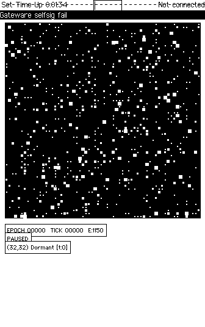
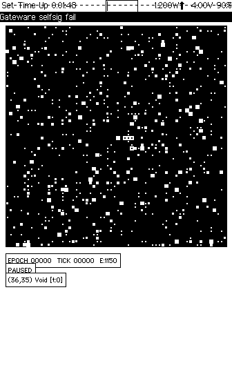
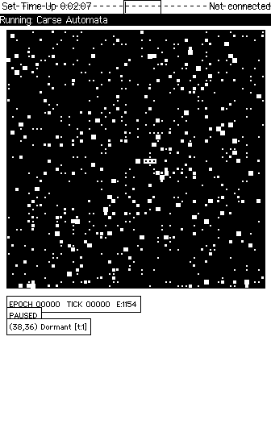
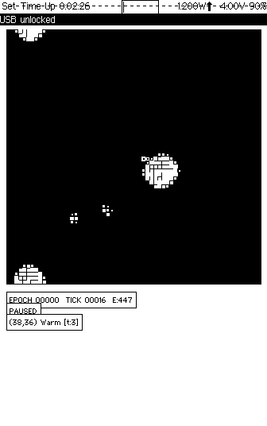
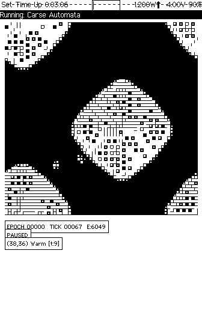
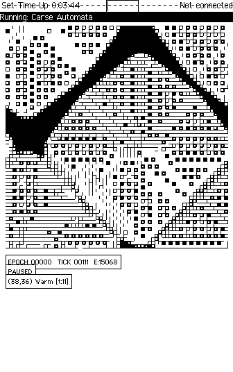
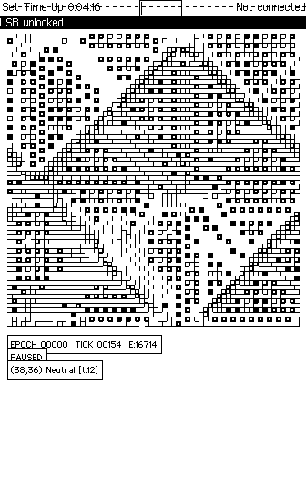

# Carse Automata

**A finitely infinite game for the Precursor platform.**

```
"There are at least two kinds of games.
One could be called finite, the other infinite.
A finite game is played for the purpose of winning,
an infinite game for the purpose of continuing the play."

— James P. Carse, Finite and Infinite Games (1986)
```

---

## What This Is

Carse Automata is a cellular automaton sandbox that runs on [Precursor](https://precursor.dev) — bunnie Huang's open-source, auditable secure computing handheld. It is not a game you win. It is a game you play.

A 64x64 toroidal grid of cells evolves through seven energy states according to hidden transition rules. The simulation runs in **epochs** — finite lifespans of emergent complexity that arise, evolve, and inevitably collapse. When one epoch dies, a new one begins. Your attention carries forward. The state does not.

You move a cursor. You touch cells. You hold spacebar and time flows. You release it and time stops. That is the entire interface.

**You are not a god. You are a gardener who can stop time.**

---

## Why This Project

Two books made this inevitable.

**James P. Carse** wrote [*Finite and Infinite Games*](https://en.wikipedia.org/wiki/Finite_and_Infinite_Games) in 1986. It is a slim, strange book about the difference between playing to win and playing to continue. Finite players play within boundaries. Infinite players play with boundaries. Most software is a finite game — you accomplish a task, you close the app, the game is over. Carse Automata refuses that framing. There is no score, no objective, no win state. There is only the next epoch.

**Stephen Wolfram** wrote [*A New Kind of Science*](https://www.wolframscience.com/nks/) in 2002 — a thousand-page argument that simple computational rules generate irreducible complexity. That you cannot predict what Rule 110 will do without running it. That the universe is, in some deep sense, a cellular automaton. Carse Automata takes this seriously: the transition rules are hidden from the player. You are a scientist, not an engineer. You observe. You hypothesize. You touch a cell and watch what happens.

The intersection of these ideas — *infinite play* and *computational irreducibility* — demanded a physical artifact. Not a website. Not a phone app. Something you hold in your hands, whose hardware you can audit, whose software you can read.

That artifact is Precursor.

---

## Why Precursor

Precursor is bunnie Huang's answer to a question most people haven't thought to ask: *what would a computer look like if you could actually trust it?*

It is an open-source handheld with a RISC-V CPU, a physical keyboard, a 336x536 monochrome display, and 16 MiB of RAM. Its operating system, [Xous](https://xous.dev), is a microkernel that communicates entirely through message passing. There is no shared memory. There are no file descriptors. Every process is an island.

These constraints are not limitations — they are the game's boundaries, and boundaries are what make play possible.

The monochrome display forced us to render seven cell states as graduated fill patterns — from solid dark (Void) to solid light (Burning), with increasingly large light rectangles for states in between. A 1-bit display has no grayscale, but the eye reads density as brightness. The constraint became the aesthetic.

The 100 MHz CPU and no GPU meant we couldn't redraw 4,096 cells every frame. So we diff: only cells that changed between ticks get redrawn, batched into draw lists of 32 rectangles at a time. The constraint became the architecture.

The keyboard-only input meant no touch screen, no mouse, no gestures. Just arrows and spacebar. So spacebar became everything: tap to touch a cell, hold to run time, hold + arrows to scrub through fossil records of dead epochs. The constraint became the interaction.

And Precursor's encrypted storage (PDDB — the Plausibly Deniable DataBase) meant the Touch Map — a permanent record of every cell you've ever attended to, across all epochs — lives in hardware-encrypted flash. Your accumulated attention is private by default. The constraint became the philosophy.

### For bunnie

The first epoch's rule seed on a fresh install is `0xBEEF`. A small nod to the person who built the hardware that makes this game possible, who has spent a career arguing that open hardware is a prerequisite for trustworthy computing, and who would probably rather we ship something interesting than write long dedications.

---

## How It Works

### The Grid

64 x 64 cells on a toroidal surface. The edges wrap — there are no boundaries, only topology. Each cell exists in one of seven energy states:

| State | Name | Visual (1-bit) | Energy |
|-------|------|-----------------|--------|
| 0 | Void | Solid dark | 0 |
| 1 | Dormant | 1px light center | 1 |
| 2 | Cool | 2x2 light center | 2 |
| 3 | Neutral | 3x3 light center | 3 |
| 4 | Warm | 4x4 light fill | 4 |
| 5 | Hot | Nearly full light | 5 |
| 6 | Burning | Solid light | 6 |

Why seven? *"And on the seventh state, it rested."*

### Controls

| Input | Action |
|-------|--------|
| Arrow keys | Move cursor |
| Spacebar (tap) | Touch cell: perturb state, increment permanent touch count |
| Spacebar (hold) | Time flows at ~10 ticks/second |
| Space + Left/Right | Scrub through fossil record of past epochs (release space to return) |
| Backspace / F4 | Save and return to the Precursor menu |

No menus. No modes. No settings. The `∴` menu key is handled by the OS; apps never receive it.

A tap that turns out to be the start of a hold is not counted as a touch: the touch is undone when the first repeat arrives.

### Hidden Rules

The transition rules are deterministic but hidden. Each tick, a cell's next state depends on its current state, its eight neighbors' states, and a seed-derived threshold system. The player discovers the rules through observation, never through documentation.

Between epochs, the rule seed mutates. The rules change. The player may not even notice.

*Reference: Wolfram's elementary cellular automata, extended to multi-state with an energy model.*

### Epochs

An epoch is one continuous run from seed to death. Death comes in three forms:

- **Heat Death**: Total energy reaches zero. The universe is cold.
- **Stagnation**: The grid enters a static state or period-2 oscillation. Nothing new can happen.
- **Collapse**: Total energy exceeds a seed-derived threshold (9,000 to 20,000; the grid maximum is 24,576). Everything burns out at once. (0.1's threshold was above the grid maximum, so this death never happened.)

When an epoch dies, a fossil record is saved and a new epoch begins. The Touch Map carries forward — cells you've attended to in past epochs are more likely to start alive in future ones.

**Epochs are finite. The chain of epochs is infinite.**

### The Touch Map

Every cell has a touch count: the number of times you've pressed spacebar on it, across all epochs, forever. The Touch Map never resets.

When a new epoch seeds, cells with higher touch counts are biased toward higher energy initial states. You are not controlling the simulation. You are biasing the probability space of every future epoch's initial conditions.

### Drift

If more than 24 hours of wall-clock time pass between sessions, the simulation applies *drift* — a few cells shift by one state, as if the world dreamed while you were away. The last-session time is the real-time clock (not uptime), so this needs the device clock to have been set; if it was never set, drift is skipped.

### Easter Eggs

There are four. One is visible in the source. Three require play to discover.

---

## Technical Architecture

```
carse-automata/
├── Cargo.toml          # app crate (package "carse"): gam, precursor-appkit, carse-core
├── manifest-fragment.json
├── capture.py          # Renode capture sequence (not yet run)
├── core/               # carse-core: pure logic, no Xous dependencies, host tests
│   └── src/{grid,rules,sim,seed,codec,input,draw}.rs
└── src/
    ├── main.rs         # registration, pump, message routing
    └── app.rs          # keys -> core, persistence, drawing
```

### Design Decisions

**Framebuffer UX** (`UxType::Framebuffer`): raw pixel control, following the ball app pattern.

**Pump and time**: a pump thread ticks every 100 ms while the app is in the foreground and stops on Background. How many generations run is computed from ticktimer deltas (`input::Pacer`), so a late tick makes up the time instead of slowing the simulation down (0.1 ran one generation per pump message). Catch-up is capped at three generations per tick after a stall.

**Diff rendering**: the shell keeps a "last drawn" grid and redraws only cells that differ from it (so touching a cell back to an earlier value redraws correctly), plus the old and new cursor cells. Cells are batched through `Screen::fill_rects`. GAM rectangles are inclusive at the bottom-right, so a 5 px cell spans offsets 0..=4 (0.1 drew 6x6 and erased its neighbours' edges).

**Saving only when something changed**: the epoch is written every 50 generations while running, and on background/leave if dirty. Pausing, scrubbing and moving the cursor write nothing. (0.1 re-wrote 4 KB and synced ten times a second while paused on a multiple of 50.)

**Validated records**: every record has a `CRS` magic, kind and version byte and is validated on read (lengths, cell states 0..=6, RLE length). 0.1 records are still read and rewritten in the new format. Unreadable or newer-version records put the app in read-only mode so they are never overwritten.

**Hidden rules via seed-derived thresholds**: numeric thresholds derived from the seed with a multiplicative hash; the seed advances each epoch.

**Randomness**: one TRNG draw per seeding seeds a local generator; TRNG failure is an error (no epoch starts, no touch is applied), never a constant.

### PDDB Storage Layout

Dictionary `carse.data`:

| Key | Size | Persistence |
|-----|------|-------------|
| `touchmap` | 16 KB + 5 (4096 x u32) | Forever |
| `epoch.current` | 4.1 KB (header + grid) | While running, on background/leave |
| `epoch.meta` | 13 bytes (wall-clock ms of last save) | Refreshed at most hourly |
| `fossil.{0-99}` | ~0.5-2 KB each (RLE, length-prefixed) | Ring of 100 epochs |

Records are replaced by delete + rewrite (PDDB keys don't shrink on a shorter write). The store reloads when the set of open PDDB bases changes.

### Limitations

- Not run on Renode or hardware yet: `capture.py` is written but unrun, and the screenshots below were taken from the 0.1 build.
- Fossil browsing loads one record per step and shows "No record" for recycled or never-saved epochs.
- The status line uses small fixed text at the grid's foot; the 64x64 grid at 5 px (320 px) fills the canvas width.

---

## Building

Carse Automata is a Xous app built inside an xous-core tree by [xous-dev-toolkit](https://github.com/tbcolby/xous-dev-toolkit):

```bash
cd xous-dev-toolkit
bin/integrate --xous-root <xous-core> --grade <path to this repo>
cd core && cargo test      # 46 host tests, no Xous needed
```

Manual integration: copy the repo to `xous-core/apps/carse/` (the `core/` crate with it), add `"apps/carse"` to workspace `members`, and merge `manifest-fragment.json` into `apps/manifest.json`. The manifest key must equal the package name (`carse`), because the GAM app name is `gam::APP_NAME_CARSE`.

---

## Screenshots

*Captured via headless Renode emulation on macOS ARM64 from the 0.1 build (before the cell-size, cursor and diff fixes). The Precursor display is 336x536 pixels, 1-bit monochrome. A Renode capture of the current build has not been run yet.*

### Initial Grid (Epoch 0, Tick 0)

The first epoch seeds with rule seed `0xBEEF`. Touch-biased random seeding scatters cells across all seven energy states. The cursor blinks at (32,32). Energy: 1,150.



### Cursor Movement

Arrow keys move the cursor across the toroidal grid. The status bar tracks position and cell state.



### Touching Cells

Spacebar tap perturbs the cell under the cursor and increments its permanent touch count. Void becomes Dormant; low-energy cells gain +1; Burning collapses to Neutral.



### Simulation Running (Tick 16)

Holding spacebar flows time at ~10 ticks/second. The hidden rules drive state transitions. Energy dropped from 1,150 to 447 — most cells decayed, but clusters formed.



### Emergent Structure (Tick 67)

The simulation produces structure that cannot be predicted without running it — Wolfram's computational irreducibility made visible. A near-perfect ellipse of void surrounds a dense multi-state nucleus. Energy: 6,049.



### Energy Cascade (Tick 111)

Energy exploded to 15,068. Void channels carve through dense burning regions. The topology of the toroidal grid becomes visible as patterns wrap across edges.



### Final State (Tick 154)

Energy: 16,714. The grid has reached a complex high-energy state. Whether this epoch dies of collapse or continues is determined by the hidden threshold — the player cannot know until it happens.



---

## The Name

**Carse**: For James P. Carse, who articulated the distinction between finite and infinite games.

**Automata**: For the cellular automata that form the substrate of the simulation.

Together: **Carse Automata** — a class of automata that play infinite games.

---

## Philosophy

Carse Automata is not a productivity tool. It is not a game you win. It is not a screensaver.

It is a **practice space**.

A place to observe without controlling. To influence without directing. To attend without expecting. To continue without finishing.

The finite player asks: *"How do I win?"*
The infinite player asks: *"How do I keep playing?"*

Carse Automata has only one answer:

**Press spacebar.**

```
CARSE AUTOMATA v0.2
Designed by Tyler Colby & Claude
For the Precursor Platform
2026

"What will you attend to?"
```

---

## Development
---

This app was developed using the methodology described in [xous-dev-toolkit](https://github.com/tbcolby/xous-dev-toolkit) — an LLM-assisted approach to Precursor app development on macOS ARM64.

## Author
---

Made by Tyler Colby — [Colby's Data Movers, LLC](https://colbysdatamovers.com)

Contact: [tyler@colbysdatamovers.com](mailto:tyler@colbysdatamovers.com) | [GitHub Issues](https://github.com/tbcolby/carse-automata/issues)

## License
---

Licensed under the Apache License, Version 2.0.

See [LICENSE](LICENSE) for the full text.
